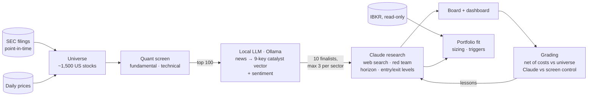

# Agentic Trader

**An advisory US-equity research agent that grades its own calls.** A free, point-in-time
quant screen narrows ~1,500 stocks to a shortlist; a local LLM reads the news; Claude does
deep research on the finalists — and every recommendation is then scored, net of costs,
against a control, so the system can tell whether the AI layer is actually adding anything.

It never places trades. Broker access is read-only.

> ⚠️ **Not financial advice.** A research tool that can be — and has been measured to be —
> wrong. Nothing here is a recommendation to buy or sell any security.

## Why this exists

Most open-source LLM trading projects report hit rates or equity curves from backtests that
sit *inside* the model's training window, where the model may simply remember what
happened. This project is built the other way round: **measurement first**.

- **Point-in-time data from free sources.** Fundamentals come from SEC filings keyed by the
  date they were *filed*, never the period end — no free source otherwise tells you what was
  knowable on a past date. The universe is rebuilt month by month from SEC registrants, so
  companies that later delisted are in the history (1,464 of 2,964 ever-members exited).
- **Every call is graded honestly.** Net of a round-trip cost, against the equal-weight
  universe (not an index the theme happens to beat), on the horizon the idea claimed.
- **The AI layer has to earn its place.** Claude's picks are compared with a screen-only
  control using a bootstrap confidence interval. LLM calls are only ever graded *forward* —
  replaying past dates through a model that has seen them is a memory test, not a backtest.
- **Multiple-testing accounting.** The backtest harness counts every distinct configuration
  ever tried and reports a Deflated Sharpe ratio against that count.
- **New signals ship dark.** An ML ranker and a catalyst pillar are computed and stored at
  weight 0 until they pass criteria fixed *before* the results were seen.

## Results so far

Walk-forward replay of the live composite on the broad universe, 106 monthly rebalances
(Oct 2017 – Jul 2026), top decile, 15 bp per side:

| | |
|---|---|
| Rank IC (does the score order the cross-section?) | **0.033**, t = 3.48, positive in 64% of months |
| Top decile vs equal-weight universe, net of costs | **+3.1% / yr**, beat it in 60% of months |
| Top decile, absolute, net | 13.6% / yr vs universe 9.7% and S&P 500 14.5% |
| Deflated Sharpe | 0.92 (bar: 0.95) |

It ranks stocks better than chance, consistently, and survives costs — but over a decade led
by mega-caps it did **not** beat the S&P 500 in absolute terms. The design goal is ranking
skill within a universe, and that is what is measured.

Findings the measurement produced, including the unflattering ones:

- **Hindsight was most of the "return".** On a hand-picked 105-stock AI-infrastructure list,
  the same composite made 34.1% / yr — but its universe made 29.9%. On the broad universe the
  numbers were 13.6% vs 10.3%. About twenty points a year came from picking the list in
  2026 knowing what those stocks did, not from the screen.
- **The technical pillar was mostly churn.** Six pre-registered weightings had statistically
  identical ranking skill; cutting technical from 0.35 to 0.20 cut turnover from 91% to 62%
  per rebalance and cost drag from 1.60% to 1.09% / yr. It was demoted on that evidence.
- **The ML ranker failed its kill criteria** (first run, curated universe: out-of-sample
  IC 0.001, t 0.08) and stays at weight 0.
- **No evidence yet that Claude beats the screen.** Early read: 140 graded buy calls vs a
  22-name control, 4-week edge −0.6 pp, 95% CI −5.0 to +3.8. The control cohort is small and
  is the next thing being redesigned.
- **The largest weight is unvalidated.** News sentiment carries 35% of the composite and
  cannot be backtested — there is no free point-in-time news archive. It is flagged as such
  everywhere it appears.

## How it works



1. **Universe and screen** — SEC registrants floored point-in-time (market cap, price,
   liquidity), scored on sector-aware fundamentals and technicals, each pillar
   percentile-ranked before weighting.
2. **News** — Google News and SEC 8-Ks for the shortlist, classified by a local model into a
   fixed catalyst vector (deal, M&A, guidance, analyst action, product cycle, regulation,
   capital return, management, adverse event) plus tone. Costs no API usage.
3. **Research** — Claude researches ~10 sector-stratified finalists with web search, states
   a holding horizon and invalidation level, and faces a devil's-advocate pass on every buy.
   Holdings get a portfolio-manager pass that reconciles actions with sizing rules
   (conviction caps, volatility target, drawdown control).
4. **Supervision and grading** — price and news triggers are checked every run; every call
   is graded later and the worst misses are distilled into lessons fed back into prompts.

Every run records per-stage **health** — `ok` means the inputs were whole; `degraded` names
the stage that wasn't — because "the process didn't crash" once hid a broker outage for five
weeks. Every report carries its prompt version and model.

## Engineering notes

- **~17k lines of Python, 350 tests**, runnable offline with a fake LLM, broker and data.
- **Point-in-time store**: partitioned Parquet; one shared metric definition (`derive()`) for
  the live screen and the backtest, so a model sees the same numbers in training and use.
- **Data-quality gate**: ratio bounds, internal consistency (impossible margins, share-count
  jumps, negative revenue), currency masking, staleness and per-sector coverage against a
  stored baseline — run on every data refresh; critical findings fail `doctor`.
- **Bring your own model**: a Claude Code subscription (headless CLI), the Anthropic API, or
  any OpenAI-compatible endpoint — OpenAI, OpenRouter, Gemini, DeepSeek, or a fully local
  Ollama / LM Studio server. Providers that cannot browse get prompts adapted to work from
  the screening context only, and their calls are tracked separately (`[no-web]`) so the
  track record never mixes the two. Ollama runs the local news stage.
- **Leak-checked history**: `scripts/preflight_public.ps1` scans files, every past file
  version, commit messages and commit identities before anything is pushed.

## Quick start

```powershell
python -m venv .venv; .\.venv\Scripts\Activate.ps1
pip install -r requirements.txt
copy .env.example .env               # add your LLM credential and an SEC contact email
python -m scripts.doctor             # tells you what is missing
python -m pytest tests -q
```

Building the data store, running the pipeline and the dashboard: **[docs/SETUP.md](docs/SETUP.md)**.

## Limitations

- US equities only (SEC data). The convenience launcher and scheduler are Windows scripts;
  the Python core is cross-platform.
- Free data has gaps: prices are split-adjusted retroactively while SEC share counts are not,
  so market cap is off by the split factor between a split and the next filing; ~600 tickers
  get no fundamentals because the SEC ticker map keeps one symbol per company.
- One decade, one market regime, ~100 independent monthly observations. Treat every
  statistic above accordingly.

## Documentation

- [docs/SETUP.md](docs/SETUP.md) — install, data store, running, configuration
- [docs/SECURITY.md](docs/SECURITY.md) — what never leaves your machine; the leak check
- [docs/IMPROVEMENT_PLAN.md](docs/IMPROVEMENT_PLAN.md) — the plan and progress log
- [docs/CODE_REVIEW_3.md](docs/CODE_REVIEW_3.md) — architecture review

## License

[MIT](LICENSE)
