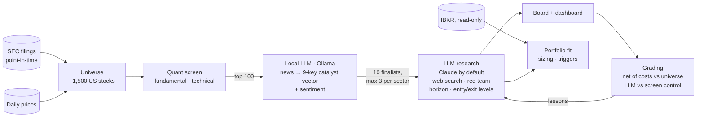

# Agentic Trader

**An LLM stock-research agent that measures whether the LLM helps.**

A free, point-in-time quant screen narrows ~1,500 US stocks to a shortlist. A local LLM
reads the news, and a frontier LLM researches the finalists. Every recommendation is then
graded forward, net of costs, against a control, so the system can tell whether the AI layer
adds anything. So far, it has not been shown to.

[](https://github.com/omershoham/claude-trader/actions/workflows/ci.yml)

[](LICENSE)


<!-- Screenshot: the maintainer will add docs/assets/dashboard.png (the Board tab of the dashboard). -->


It never places trades, and broker access is read-only.

> **Not financial advice.** This is a research tool. It can be wrong, and measurements show
> that it has been. Nothing here is a recommendation to buy or sell any security.

## Try it in 4 minutes

No API keys and no broker needed. All data is free.

```bash
python -m venv .venv
source .venv/bin/activate        # Windows: .\.venv\Scripts\Activate.ps1
pip install -r requirements.txt
python -m scripts.demo           # builds a sandbox, runs the screen, opens the dashboard
```

The demo creates a sandboxed workspace (`./demo`) for ~35 US large caps, loads five years of
prices and SEC filings, runs the quant screen, and opens the dashboard at
http://localhost:8502. It never touches your real workspace.

- Ollama is used for the news stage if it is running. Otherwise that pillar is neutral, and
  the run's health says so.
- `--research` adds LLM research on the top three names, using whichever provider you
  configure (see [Bring your own model](#bring-your-own-model)).
- `--reset` starts the demo over.

Or with Docker (the dashboard is then at http://localhost:8502):

```bash
docker build -t claude-trader .
docker run --rm -it -p 8502:8502 -e SEC_CONTACT_EMAIL=you@example.com \
    -v claude-trader-demo:/data claude-trader
```

Add `--skip-data` to re-run on the data already in the volume. Details:
[docs/SETUP.md](docs/SETUP.md#docker).

## Why this exists

Most open-source LLM trading projects report hit rates or equity curves from backtests that
fall *inside* the model's training window, where the model may simply remember what
happened. This project is built the other way round: **measurement first**.

- **Point-in-time data from free sources.** Fundamentals come from SEC filings keyed by the
  date they were *filed*, never by the period end. The universe is rebuilt month by month
  from SEC registrants, so companies that later delisted are included in the history (1,464
  of 2,964 ever-members exited).
- **Every call is graded honestly.** Grades are net of a round-trip cost, measured against
  the equal-weight universe (not an index the theme happens to beat), on the horizon the
  idea claimed.
- **The AI layer has to earn its place.** The LLM's picks are compared with a screen-only
  control using a bootstrap confidence interval. LLM calls are only ever graded *forward*:
  replaying past dates through a model that has seen them is a memory test, not a backtest.
- **Multiple-testing accounting.** The backtest harness counts every distinct configuration
  ever tried and reports a Deflated Sharpe ratio against that count.
- **New signals ship dark.** An ML ranker and a catalyst pillar are computed and stored at
  weight 0 until they pass criteria that were fixed *before* the results were seen.

## Results so far

The live composite was replayed walk-forward on the broad universe: 106 monthly rebalances
(Oct 2017 – Jul 2026), top decile, 15 bp per side.

| | |
|---|---|
| Rank IC (does the score order the cross-section?) | **0.033**, t = 3.48, positive in 64% of months |
| Top decile vs equal-weight universe, net of costs | **+3.1% / yr**, beat it in 60% of months |
| Top decile, absolute, net | 13.6% / yr vs universe 9.7% and S&P 500 14.5% |
| Deflated Sharpe | 0.92 (bar: 0.95) |

The screen ranks stocks better than chance, consistently, and survives costs. But over a
decade led by mega-caps, it did **not** beat the S&P 500 in absolute terms. The design goal is
ranking skill within a universe, and that is what is measured.

### What the measurements found, including the unflattering results

- **Hindsight was most of the "return".** On a hand-picked 105-stock AI-infrastructure list,
  the same composite made 34.1% / yr, but its universe made 29.9%. On the broad universe the
  numbers were 13.6% vs 10.3%. About twenty points a year came from picking the list in 2026
  already knowing what those stocks did, not from the screen.
- **The technical pillar was mostly churn.** Six pre-registered weightings had statistically
  identical ranking skill. Cutting technical from 0.35 to 0.20 cut turnover from 91% to 62%
  per rebalance, and cost drag from 1.60% to 1.09% / yr. It was demoted on that evidence.
- **The ML ranker failed its kill criteria** (first run, curated universe: out-of-sample
  IC 0.001, t 0.08). It stays at weight 0.
- **No evidence yet that the LLM layer (Claude) beats the screen.** Early read: 140 graded buy calls vs a
  22-name control. The 4-week edge was −0.6 pp (95% CI −5.0 to +3.8). The control cohort is
  small, and redesigning it is the next step.
- **The largest weight is unvalidated.** News sentiment carries 35% of the composite, and it
  cannot be backtested because no free point-in-time news archive exists. It is flagged as
  unvalidated everywhere it appears.

## How it compares

Several popular projects are further along than this one in other directions. What is rare
is the measurement layer. This is a compact view; see
**[docs/COMPARISON.md](docs/COMPARISON.md)** for per-cell sources and caveats. "—" means not
documented or not applicable; it does not mean the feature is absent.

| As of 2026-09-27 | This project | [TradingAgents](https://github.com/TauricResearch/TradingAgents) | [ai-hedge-fund](https://github.com/virattt/ai-hedge-fund) | [Vibe-Trading](https://github.com/HKUDS/Vibe-Trading) | [FinRobot](https://github.com/AI4Finance-Foundation/FinRobot) |
|---|---|---|---|---|---|
| GitHub stars | new | 108.8k | 63.8k | 34.1k | 8.1k |
| Point-in-time fundamentals | Yes, default | Yes, opt-in (v0.5.0) | In progress | Yes (factor set) | — |
| Survivorship-aware universe | Yes | — (you pick tickers) | — (you pick tickers) | — | — |
| Cost-net grading vs a control | Yes | Benchmark alpha, costs — | Benchmark, no costs yet | Yes | — |
| Multiple-testing accounting | Yes | — | Planned | Library functions | — |
| LLM graded forward only | Yes | Partial | Masked replay | Different design | — |
| Tests whether the LLM beats a non-LLM baseline | Yes (no edge yet) | — | — | — | — |
| Local models | Yes | Yes | Planned | Yes | — |
| Multi-agent debate | No | Yes | Personas | Yes | Yes |
| Markets | US equities | Global equities, crypto | Stocks | Multi-asset, 7+ markets | Equities |
| Broker | IBKR read-only | Simulated | Simulated | 18 brokers | — |
| Places live orders | Never | No | No (planned) | Yes, opt-in | — |
| Free data only | Yes | Yes (default) | No | Yes (default) | No |

The others are ahead on community size, multi-agent reasoning, market coverage, execution
and interfaces, and FinRobot does real valuation modeling. This project is narrower and
aims to show honestly whether its AI layer is worth anything.

## How it works



1. **Universe and screen.** SEC registrants are filtered point-in-time (market cap, price,
   liquidity) and scored on sector-aware fundamentals and technicals. Each pillar is
   percentile-ranked before weighting.
2. **News.** Google News and SEC 8-Ks are gathered for the shortlist. A local model
   classifies them into a fixed catalyst vector (deal, M&A, guidance, analyst action, product
   cycle, regulation, capital return, management, adverse event) plus tone. This stage uses
   no API.
3. **Research.** The research model studies ~10 sector-stratified finalists with web search.
   It states a holding horizon and an invalidation level, and every buy faces a
   devil's-advocate pass. Holdings get a portfolio-manager pass that reconciles actions with
   sizing rules (conviction caps, volatility target, drawdown control).
4. **Supervision and grading.** Price and news triggers are checked on every run. Every call
   is graded later, and the worst misses are distilled into lessons fed back into prompts.

Every run records per-stage **health**. `ok` means the inputs were whole; `degraded` names
the stage that wasn't. This exists because "the process didn't crash" once hid a broker
outage for five weeks. Every report carries its prompt version and model.

## Bring your own model

The research stage runs on whichever provider you set in `config.yaml` (`llm.provider`):

| Provider | What it uses | Web search |
|---|---|---|
| `claude_cli` (default) | The [Claude Code](https://claude.com/claude-code) CLI, headless, on your subscription. The only provider for the dashboard's Investigate mode | Yes |
| `anthropic_api` | An Anthropic API key (per-token billing) | Yes |
| `openai_compat` | Any OpenAI-compatible endpoint. Presets: `openai`, `openrouter`, `gemini`, `deepseek`, `ollama`, `lmstudio`, or your own `base_url` | Only if the model really browses |

To run fully locally, with no API key and no cost:

```yaml
llm:
  provider: openai_compat
  openai_compat: {preset: ollama, model: "qwen3.5:9b"}
```

Providers that cannot browse get prompts adapted to work from the screening context only,
and their reports are labelled `[no-web]`. That keeps their track record separate from
web-researched calls. The news stage runs on a local Ollama model
(`local_llm.model`) when one is available. `python -m scripts.doctor` tells you whether your provider is ready.

## Engineering notes

- **~20k lines of Python (~14k application, ~5.5k tests), 377 tests.** The suite runs offline
  with a fake LLM, broker and data; one slow test that parses real SEC archives is opt-in.
- **Point-in-time store.** Partitioned Parquet, with one shared metric definition
  (`derive()`) for both the live screen and the backtest, so a model sees the same numbers in
  training and in use.
- **Data-quality gate.** Checks ratio bounds, internal consistency (impossible margins,
  share-count jumps, negative revenue), currency masking, staleness, and per-sector coverage
  against a stored baseline. It runs on every data refresh, and critical findings fail
  `doctor`.
- **Provider seam.** Every research call goes through one small protocol (`src/llm/`), so
  tests substitute a fake and each back end is one module.
- **Leak-checked history.** Before anything is pushed, `scripts/preflight_public.ps1` scans
  files, every past file version, commit messages and commit identities.

## Your own setup

```bash
cp .env.example .env              # Windows: copy. Add your LLM credential and an SEC contact email
python -m scripts.doctor          # tells you what is missing
python -m pytest tests -q
```

**[docs/SETUP.md](docs/SETUP.md)** covers building the full point-in-time data store (about an
hour on the first run), the daily pipeline, the dashboard, backtests and configuration.

## Limitations

- US equities only (SEC data). The convenience launcher and scheduler are Windows scripts;
  the Python core is cross-platform.
- Free data has gaps. Prices are split-adjusted retroactively, but SEC share counts are not,
  so market cap is off by the split factor between a split and the next filing. About 600
  tickers get no fundamentals, because the SEC ticker map keeps one symbol per company.
- One decade, one market regime, and about 100 independent monthly observations. Weigh
  every statistic above accordingly.
- The LLM-vs-screen comparison rests on a small control group and a few months of forward
  data. It is an early read, not a verdict.

## Documentation

- [docs/SETUP.md](docs/SETUP.md): install, data store, running, configuration
- [docs/COMPARISON.md](docs/COMPARISON.md): detailed, sourced comparison with similar projects
- [docs/SECURITY.md](docs/SECURITY.md): what never leaves your machine, and the leak check
- [CONTRIBUTING.md](CONTRIBUTING.md): dev setup, research rules for new signals, theme packs, LLM providers
- [docs/IMPROVEMENT_PLAN.md](docs/IMPROVEMENT_PLAN.md): the plan and progress log
- [docs/CODE_REVIEW_3.md](docs/CODE_REVIEW_3.md): architecture review

## Contributing

Issues and pull requests are welcome, especially corrections to
[docs/COMPARISON.md](docs/COMPARISON.md) and new signals that come with a pre-registered test.
See [CONTRIBUTING.md](CONTRIBUTING.md).

## License

[MIT](LICENSE)

## Disclaimer

This software is for research and education. It is not financial, investment, tax or
trading advice, and it is not a solicitation to buy or sell any security. Its outputs can be
wrong, stale or incomplete. Past performance, backtested or live, does not predict future
results. You are solely responsible for your own investment decisions.
